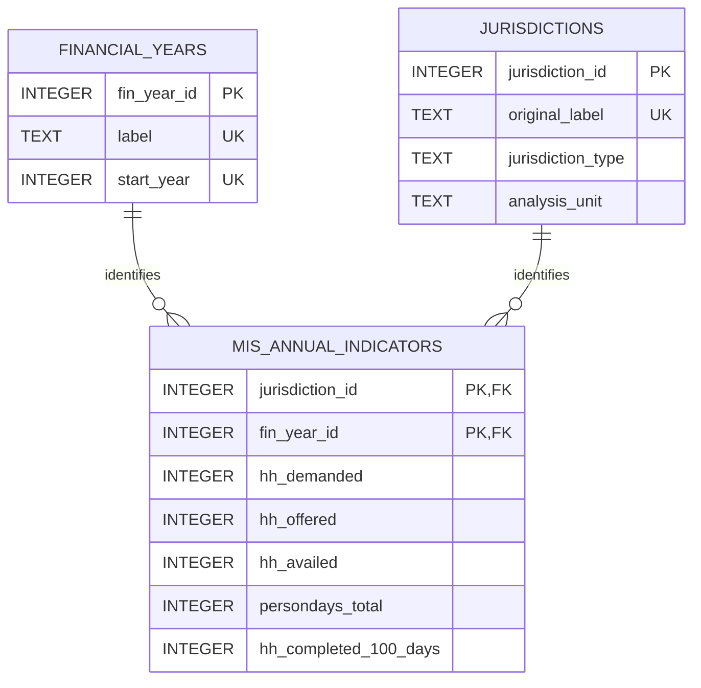

# From Legal Guarantee to Recorded Delivery

*A descriptive analysis of recorded MGNREGA employment outcomes across 32 displayed jurisdictions.*

This project uses SQLite and SQL to examine recorded household employment demand, offers, employment availed, persondays, and 100-day completion figures across 11 financial years, FY 2014–15 through FY 2024–25.

The dataset covers 32 jurisdictions displayed in the local source reports. It is not established as complete all-India State/UT coverage. The analysis describes recorded patterns; it does not establish why employment gaps occur or make causal claims.

## Research questions

1. How did households availing employment compare with household employment demand across displayed jurisdictions, and which jurisdictions repeatedly recorded gaps?
2. How did total persondays and families/households recorded as completing 100 days vary across jurisdictions and over time?
3. How did persondays and the gap between employment demand and employment availed differ across the pre-pandemic, pandemic, and post-pandemic periods?

## Dataset and coverage

The primary analysis dataset contains **352 jurisdiction-year observations**: 32 displayed jurisdictions for each of 11 financial years, FY 2014–15 through FY 2024–25.

The consolidated input is [`cs50-data-export/mgnrega_annual_indicators.csv`](cs50-data-export/mgnrega_annual_indicators.csv). Its columns are:

- `jurisdiction`
- `fin_year`
- `employment_demanded_household`
- `employment_offered_household`
- `employment_availed_household`
- `total_persondays`
- `families_completed_100_days`

The project also retains 11 annual MIS reports in [`data/raw/mis_reports/`](data/raw/mis_reports/) and annual report-shaped CSVs in [`data/staging/`](data/staging/). The `.xls` reports are HTML tables despite their file extensions. Each report has 32 jurisdiction rows and a separate `Total` row; the `Total` row is not a jurisdiction observation.

Two supplementary CSVs are retained in the project root:

- [`syb-18-chapter_35_rural_urban_development_state_table_35.1.csv`](syb-18-chapter_35_rural_urban_development_state_table_35.1.csv) — historical state/UT figures for FY 2010–11 to FY 2017–18.
- [`RS_Session_265_AU_622_A_i.csv`](RS_Session_265_AU_622_A_i.csv) — parliamentary 100-day completion figures for FY 2019–20 to FY 2023–24.

They are retained as supplementary validation/context sources, not loaded into the primary indicator table.

The [data validation report](outputs/mgnrega_data_validation_report.md) records that Kerala, Maharashtra, Chandigarh, and Delhi are absent from all local MIS reports; the reason is unresolved. Their absence is not treated as zero employment. It also notes unresolved historical geography conventions for Ladakh and the combined `DN HAVELI AND DD` label. Do not interpret the primary dataset as complete all-India coverage.

## Database structure

The rebuilt database is generated as a separate file by the steps below and has three permanent tables:

- `financial_years` — financial-year IDs, labels, and start years.
- `jurisdictions` — jurisdiction IDs, original labels, jurisdiction types, and analysis units.
- `mis_annual_indicators` — one observation per jurisdiction and financial year.

The indicator table has a composite primary key on `(jurisdiction_id, fin_year_id)`, foreign keys to both reference tables, and nonnegative checks on its indicator fields.

The local files `mgnrega.db` and `mgnrega_rebuild.db` are database files in the working folder and are not included in the GitHub repository. The existing `mgnrega.db` includes the `staging_raw` table for the annual-report workflow. The consolidated rebuild uses a TEMP staging table and retains only the three permanent tables defined in `schema.sql`.



## Methodology and data-loading workflow

The SQL calculates:

- **Household fulfilment rate:** households availing employment divided by households demanding employment, multiplied by 100.
- **Household offer rate:** households offered employment divided by households demanding employment, multiplied by 100.
- **Persondays per availing household:** total persondays divided by households availing employment.
- **100-day completion rate:** families recorded as completing 100 days divided by households availing employment.

Queries use `NULLIF` for zero denominators. In the saved rate output, 15 zero-demand observations have blank (NULL) fulfilment and offer rates. These are not interpreted as zero performance.

### Query 3 screening rule

Query 3 flags jurisdictions with fulfilment below 90% in at least six eligible years. Eligible years have nonzero household demand. This rule gives the broader “repeated gaps” question a consistent descriptive screen: the 90% cutoff defines a below-threshold year, and six years defines recurrence.

The project files do not document why those particular cutoffs were selected. They are analytical conventions, not statutory standards, evidence of a legal entitlement threshold, or proof of causes.

### Pandemic-period rule

Query 6 groups years as follows:

- Pre-pandemic: FY 2014–15 through FY 2019–20.
- Pandemic: FY 2020–21 and FY 2021–22.
- Post-pandemic: FY 2022–23 through FY 2024–25.

The query calculates rates from pooled period totals and expresses persondays and the demand–availed gap as annual averages. These comparisons are descriptive, not causal.

The project keeps “employment offered” distinct from “employment provided.” It also does not assume that “families completing 100 days” is equivalent to differently worded household measures in supplementary sources.

### Rebuild from the consolidated CSV

The workflow uses the SQLite command-line shell. Run it from the project root. The commands below create a unique database file in the system temporary directory, so they do not overwrite either existing database. Keep the printed path if you want to retain the rebuilt database.

```bash
DB_FILE="$(mktemp "${TMPDIR:-/tmp}/mgnrega-rebuild.XXXXXX")"
printf 'Building database at: %s\n' "$DB_FILE"
sqlite3 "$DB_FILE"
```

At the SQLite prompt:

```sql
.bail on
PRAGMA foreign_keys = ON;
.read schema.sql

CREATE TEMP TABLE consolidated_staging (
    jurisdiction TEXT,
    fin_year TEXT,
    employment_demanded_household TEXT,
    employment_offered_household TEXT,
    employment_availed_household TEXT,
    total_persondays TEXT,
    families_completed_100_days TEXT
);

.mode csv
.import --skip 1 cs50-data-export/mgnrega_annual_indicators.csv consolidated_staging

.read seed.sql
```

The `.import` command is a sqlite3 shell command, not SQL in `seed.sql`. The seed file inserts the reference rows, maps the staged jurisdiction and financial-year labels to their IDs, loads the indicators, and drops the temporary staging table. The separate annual-report workflow remains documented in [`import_instruction.md`](import_instruction.md) and uses [`staging.sql`](staging.sql).

Check the rebuilt database:

```sql
.mode column
SELECT COUNT(*) AS financial_years FROM financial_years;
SELECT COUNT(*) AS jurisdictions FROM jurisdictions;
SELECT COUNT(*) AS observations FROM mis_annual_indicators;
SELECT COUNT(DISTINCT jurisdiction_id) AS represented_jurisdictions
FROM mis_annual_indicators;
SELECT COUNT(DISTINCT fin_year_id) AS represented_financial_years
FROM mis_annual_indicators;
PRAGMA foreign_key_check;
```

Expected counts are 11 financial years, 32 jurisdictions, and 352 observations, representing 32 jurisdictions and 11 years. `PRAGMA foreign_key_check` should return no rows.

To run the seven analyses in the same SQLite session:

```sql
.read queries.sql
```

## Analytical queries

[`queries.sql`](queries.sql) contains seven queries:

1. Retrieve annual employment indicators for a selected jurisdiction and year.
2. Calculate household fulfilment and offer rates by jurisdiction and year.
3. Identify jurisdictions meeting the repeated below-90% fulfilment screen.
4. Compare persondays per availing household and 100-day completion rates.
5. Show annual demand and employment-availed trends with year-on-year percentage changes.
6. Compare pooled rates and average annual outcomes across the three periods.
7. Flag records where households offered exceed households demanded, or households availing exceed households offered.

Saved results are in [`outputs/results/`](outputs/results/). The result index, [`outputs/results/README.md`](outputs/results/README.md), lists each CSV and its row count. The saved results are dated 12 November 2026; the findings below come from those files and were not rerun for this README.

## Findings in the saved query outputs

- **Selected-year example (Query 1):** For Bihar in FY 2020–21, the saved row reports 6,168,223 households demanding employment, 6,159,570 offered, and 5,064,962 availing; it reports 226,125,900 persondays and 34,752 families completing 100 days.
- **Zero-demand rates (Query 2):** The output has 352 rows. Fifteen zero-demand observations have NULL fulfilment and offer rates.
- **Repeated fulfilment gaps (Query 3):** The output contains 13 jurisdictions. Its `years_below_90` counts are:

  | Jurisdiction | Eligible years | Years below 90% |
  |---|---:|---:|
  | ANDAMAN AND NICOBAR | 11 | 7 |
  | BIHAR | 11 | 11 |
  | CHHATTISGARH | 11 | 10 |
  | GUJARAT | 11 | 11 |
  | HARYANA | 11 | 11 |
  | JHARKHAND | 11 | 10 |
  | LAKSHADWEEP | 10 | 6 |
  | MADHYA PRADESH | 11 | 10 |
  | ODISHA | 11 | 8 |
  | PUDUCHERRY | 11 | 9 |
  | PUNJAB | 11 | 11 |
  | TELANGANA | 11 | 8 |
  | UTTAR PRADESH | 11 | 8 |

- **Employment intensity and 100-day rates (Query 4):** The saved output contains 352 jurisdiction-year rows.
- **Year-on-year trends (Query 5):** The saved output contains 352 jurisdiction-year rows.
- **Period comparison (Query 6):**

  | Period | Fulfilment rate | Offer rate | Average annual demand–availed gap | Average annual persondays |
  |---|---:|---:|---:|---:|
  | Pre-pandemic | 89.38% | 99.65% | 5,579,274.333333333 | 2,190,595,823.8333335 |
  | Pandemic | 89.07% | 99.72% | 8,651,232.5 | 3,579,429,701.0 |
  | Post-pandemic | 90.84% | 99.84% | 5,631,155.666666667 | 2,779,029,115.6666665 |

  These are the saved query values and describe differences across the specified periods; they do not establish a pandemic effect.

- **Unusual recorded relationships (Query 7):** The output flags nine jurisdiction-year rows meeting the query’s stated conditions. For example, it includes Tripura FY 2015–16, where the saved row has 580,277 households offered versus 580,232 demanded, and Andhra Pradesh FY 2016–17, where 3,989,775 households availed versus 3,979,060 offered. These are flags for review, not explanations of cause.

The saved result CSVs are [`query_1_selected_jurisdiction_year.csv`](outputs/results/query_1_selected_jurisdiction_year.csv), [`query_2_fulfilment_offer_rates.csv`](outputs/results/query_2_fulfilment_offer_rates.csv), [`query_3_recurring_fulfilment_gaps.csv`](outputs/results/query_3_recurring_fulfilment_gaps.csv), [`query_4_employment_intensity_100day.csv`](outputs/results/query_4_employment_intensity_100day.csv), [`query_5_annual_trends_yoy_changes.csv`](outputs/results/query_5_annual_trends_yoy_changes.csv), [`query_6_pandemic_period_comparison.csv`](outputs/results/query_6_pandemic_period_comparison.csv), and [`query_7_unusual_source_relationships.csv`](outputs/results/query_7_unusual_source_relationships.csv).

## Tools

- SQLite and the sqlite3 command-line shell.
- SQL for schema design, reference data, loading, and analysis.
- CSV for the consolidated dataset, report staging files, and saved query results.

## Project files

- [`schema.sql`](schema.sql) — permanent table definitions.
- [`seed.sql`](seed.sql) — reference data and consolidated indicator load.
- [`queries.sql`](queries.sql) — seven analytical queries.
- [`staging.sql`](staging.sql) and [`import_instruction.md`](import_instruction.md) — separate annual MIS report workflow.
- [`PROJECT_STATUS.md`](PROJECT_STATUS.md) — project notes and status.
- [`outputs/mgnrega_data_validation_report.md`](outputs/mgnrega_data_validation_report.md) — source validation and comparability audit.
